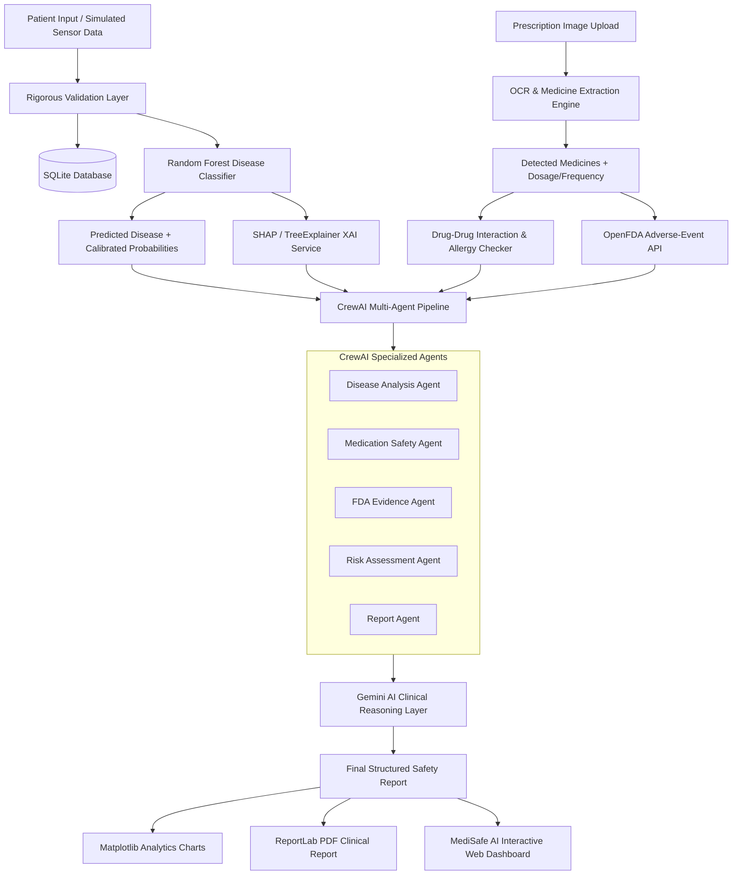

# Implementation Plan: MediSafe AI Clinical Decision Support Dashboard

MediSafe AI is a complete, clinical-grade decision-support prototype integrating disease risk prediction (Random Forest), explainable AI (SHAP), prescription OCR, drug-drug interaction checking, OpenFDA adverse event safety data, multi-agent evaluation (CrewAI), Gemini AI structured synthesis, real-time sensor/vitals simulation, Matplotlib visual analytics, and ReportLab PDF clinical export.

> [!IMPORTANT]
> **Clinical Decision-Support Notice:**
> MediSafe AI is strictly an AI-assisted decision-support prototype. It does not provide confirmed medical diagnoses, nor does it prescribe, alter, or discontinue patient medications. All insights are clearly marked: *"AI-generated decision support — professional verification required."*

---

## User Review Required

1. **Port & Local Host**: The backend and web dashboard will run unified on **`http://localhost:8000`** with a modern responsive medical UI serving all 11 core sections.
2. **AI API Key**: Google Gemini API key (`GOOGLE_API_KEY`) will be supported via `.env` or system environment. If an API key is not yet set or offline, a robust, deterministic clinical reasoning fallback engine will execute the multi-agent reasoning so all features work seamlessly out of the box.
3. **Random Forest Dataset & Model**: A high-fidelity clinical dataset matching the exact specified 10 features (*Age, Gender, BMI, Glucose, BP, Cholesterol, Heart_Rate, HbA1c, Smoking, Symptoms*) will be trained and serialized as a production `random_forest_model.joblib` with calibrated probabilities for key conditions (Diabetes, Hypertension, Heart Disease, Asthma, Chronic Kidney Disease).

---

## Architecture & System Flow

---

## Proposed Changes & File Structure

### Backend Modules (`backend/`)

#### [NEW] [main.py](file:///c:/Users/Jeeva/OneDrive/Documents/Antigravity_projects_file/backend/main.py)
- FastAPI application entry point.
- Configures CORS, mounts static assets, serves the dashboard, initializes SQLite database on startup, registers route routers.

#### [NEW] [database.py](file:///c:/Users/Jeeva/OneDrive/Documents/Antigravity_projects_file/backend/database.py)
- SQLite database schema & connection manager using SQLAlchemy-compatible structures.
- Tables: `patients`, `vital_readings`, `predictions`, `prescriptions`, `drug_interactions`, `fda_queries`, `agent_reports`.

#### [NEW] [models/schemas.py](file:///c:/Users/Jeeva/OneDrive/Documents/Antigravity_projects_file/backend/models/schemas.py)
- Pydantic models for PatientInput, SensorReading, PredictionResponse, PrescriptionUpload, InteractionCheck, FDACheck, AIAnalysisResponse, and SystemStatus.

#### [NEW] [routes/patient.py](file:///c:/Users/Jeeva/OneDrive/Documents/Antigravity_projects_file/backend/routes/patient.py)
- Patient CRUD operations, listing historical patients, retrieving patient vitals and trends.

#### [NEW] [routes/sensor.py](file:///c:/Users/Jeeva/OneDrive/Documents/Antigravity_projects_file/backend/routes/sensor.py)
- Real-time simulated sensor streaming endpoints: `POST /api/sensor/start`, `POST /api/sensor/stop`, `POST /api/sensor/reset`, `GET /api/sensor/stream` (SSE/WebSocket/Polling) + `POST /api/sensor/reading` (supports simulated or physical ESP32/MQTT inputs).

#### [NEW] [routes/prediction.py](file:///c:/Users/Jeeva/OneDrive/Documents/Antigravity_projects_file/backend/routes/prediction.py)
- `POST /predict` endpoint running Random Forest inference and returning calibrated disease probabilities.

#### [NEW] [routes/xai.py](file:///c:/Users/Jeeva/OneDrive/Documents/Antigravity_projects_file/backend/routes/xai.py)
- `POST /api/xai/explain` computes SHAP values, feature importance ranking, and positive/negative feature contributions.

#### [NEW] [routes/prescription.py](file:///c:/Users/Jeeva/OneDrive/Documents/Antigravity_projects_file/backend/routes/prescription.py)
- `POST /api/prescription/upload` handles OCR text extraction, medicine detection, dosage, frequency, and duration parsing.

#### [NEW] [routes/medication.py](file:///c:/Users/Jeeva/OneDrive/Documents/Antigravity_projects_file/backend/routes/medication.py)
- Drug-drug interaction checking, allergy cross-matching, condition contraindications.

#### [NEW] [routes/fda.py](file:///c:/Users/Jeeva/OneDrive/Documents/Antigravity_projects_file/backend/routes/fda.py)
- Integration with OpenFDA adverse-event API (`https://api.fda.gov/drug/event.json`) for adverse reaction counts, report IDs, seriousness statistics.

#### [NEW] [routes/analysis.py](file:///c:/Users/Jeeva/OneDrive/Documents/Antigravity_projects_file/backend/routes/analysis.py)
- Orchestrates the 5-Agent CrewAI pipeline and Gemini clinical reasoning layer to generate the final safety report and risk level (`LOW`, `MODERATE`, `HIGH`, `URGENT`).

#### [NEW] [routes/report.py](file:///c:/Users/Jeeva/OneDrive/Documents/Antigravity_projects_file/backend/routes/report.py)
- Matplotlib chart generation (downloadable PNGs) and ReportLab PDF clinical report generation (`GET /api/report/pdf/{patient_id}`).

#### [NEW] [routes/system.py](file:///c:/Users/Jeeva/OneDrive/Documents/Antigravity_projects_file/backend/routes/system.py)
- `GET /api/system/status`: Real-time health checks for Random Forest, SHAP, OCR, OpenFDA API, Gemini, CrewAI, Database, and Sensor Simulator.

---

### Backend Services (`backend/services/`)

#### [NEW] [random_forest_service.py](file:///c:/Users/Jeeva/OneDrive/Documents/Antigravity_projects_file/backend/services/random_forest_service.py)
- Trains/loads Random Forest classifier on the 10 specified features (*Age, Gender, BMI, Glucose, BP, Cholesterol, Heart_Rate, HbA1c, Smoking, Symptoms*). Exposes `predict_disease()`.
- Guarantees strict rule adherence: sensor-only parameters (SpO2, temperature) are NOT injected into the RF model.

#### [NEW] [shap_service.py](file:///c:/Users/Jeeva/OneDrive/Documents/Antigravity_projects_file/backend/services/shap_service.py)
- Computes `shap.TreeExplainer` feature attribution values for any patient sample with graceful fallback.

#### [NEW] [ocr_service.py](file:///c:/Users/Jeeva/OneDrive/Documents/Antigravity_projects_file/backend/services/ocr_service.py)
- Multi-engine prescription parser extracting text, medicine entities, dosage, frequency, and instructions.

#### [NEW] [fda_service.py](file:///c:/Users/Jeeva/OneDrive/Documents/Antigravity_projects_file/backend/services/fda_service.py)
- Queries OpenFDA API with retry, rate-limiting, and caching for medicine adverse events.

#### [NEW] [drug_interaction_service.py](file:///c:/Users/Jeeva/OneDrive/Documents/Antigravity_projects_file/backend/services/drug_interaction_service.py)
- Clinical interaction database cross-referencing known active ingredients, severity levels (Major, Moderate, Minor), and allergy conflicts.

#### [NEW] [crewai_service.py](file:///c:/Users/Jeeva/OneDrive/Documents/Antigravity_projects_file/backend/services/crewai_service.py)
- Implements the 5 specialized agents:
  1. *Disease Analysis Agent*
  2. *Medication Safety Agent*
  3. *FDA Evidence Agent*
  4. *Risk Assessment Agent*
  5. *Report Agent*

#### [NEW] [gemini_service.py](file:///c:/Users/Jeeva/OneDrive/Documents/Antigravity_projects_file/backend/services/gemini_service.py)
- Synthesizes all verified clinical findings into structured decision support adhering strictly to clinical disclaimers.

#### [NEW] [visualization_service.py](file:///c:/Users/Jeeva/OneDrive/Documents/Antigravity_projects_file/backend/services/visualization_service.py)
- High-resolution Matplotlib charts: Disease probabilities, SHAP contribution waterfall/bar, vital time-series trends, FDA adverse events.

#### [NEW] [pdf_service.py](file:///c:/Users/Jeeva/OneDrive/Documents/Antigravity_projects_file/backend/services/pdf_service.py)
- ReportLab multi-page professional clinical report generator.

---

### Frontend Web Dashboard (`frontend/`)

#### [NEW] [index.html](file:///c:/Users/Jeeva/OneDrive/Documents/Antigravity_projects_file/frontend/index.html)
- Single-page application architecture with 11 distinct view sections:
  1. Dashboard
  2. Patient Data & Intake
  3. Disease Prediction
  4. Explainable AI (SHAP)
  5. Prescription OCR
  6. Medication Safety & Interactions
  7. FDA Safety Information
  8. CrewAI Multi-Agent Analysis
  9. Final Safety Report
  10. Reports & PDF Export
  11. System Status
- Sidebar navigation, top bar with active patient banner, simulated sensor live pill indicator, theme toggle, and clinical disclaimer header.

#### [NEW] [style.css](file:///c:/Users/Jeeva/OneDrive/Documents/Antigravity_projects_file/frontend/style.css)
- Custom CSS design system with medical color tokens (`--primary-teal`, `--clinical-blue`, `--slate-dark`, `--danger-rose`, `--warning-amber`, `--success-emerald`), glassmorphism card components, responsive grid layouts, status badges, and micro-animations.

#### [NEW] [app.js](file:///c:/Users/Jeeva/OneDrive/Documents/Antigravity_projects_file/frontend/app.js)
- Core dashboard logic: navigation state, reactive patient state, live simulated vitals chart updating in real-time, interactive prediction submission, SHAP bar rendering, drag-and-drop prescription upload, FDA live search, CrewAI & Gemini workflow triggers, and PDF download triggers.

---

## Verification Plan

### Automated & Integration Tests
1. **Model & SHAP Integrity Test**:
   - Run inference through `random_forest_service.py` with 10 patient features; verify calibrated output probabilities sum to 100%.
   - Compute SHAP values with `shap_service.py`; verify feature attribution values match the input dimension.
2. **OpenFDA API Connectivity Test**:
   - Query common medications (e.g. `Metformin`, `Lisinopril`, `Aspirin`) and verify adverse event counts, reactions, and disclaimers.
3. **Multi-Agent & Gemini Pipeline Test**:
   - Execute the 5-Agent workflow with simulated clinical case data; verify Safety Level categorizations (`LOW`, `MODERATE`, `HIGH`, `URGENT`).
4. **PDF Generation Test**:
   - Generate test clinical report; verify PDF creates cleanly with tables, charts, and disclaimers.

### Manual Verification via Browser Subagent
1. Launch FastAPI server at `http://127.0.0.1:8000`.
2. Use browser subagent to navigate to `http://127.0.0.1:8000`:
   - Load dashboard and verify System Status shows active services.
   - Enter patient details or load a pre-configured clinical profile.
   - Start simulated monitoring and verify live vitals update on the charts.
   - Run Disease Prediction and verify SHAP explanations.
   - Upload sample prescription and verify medicine extraction.
   - Check FDA safety and drug interactions.
   - Run AI Safety Analysis and generate PDF report.
